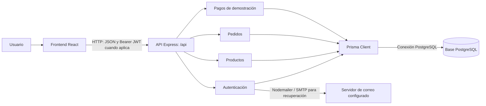
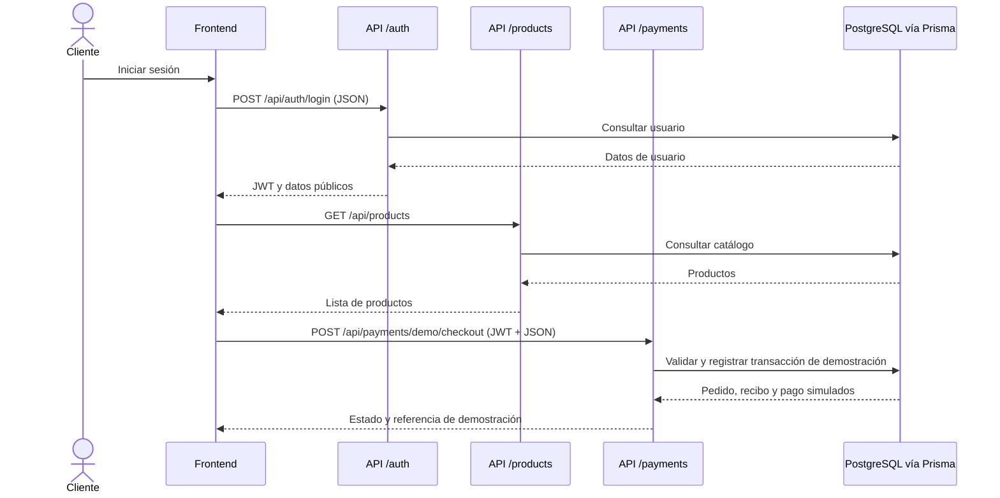

# Comunicación entre API y servicios de Estuche Virtual

**Revisión estática:** 27-11-2026, base `d3d68addf2c93782209161b696d1c5fc342d75ff`. Describe el código del repositorio, no certifica un despliegue ni una prueba con una base remota. El alcance compara cuatro **áreas funcionales** —autenticación, productos, pedidos y pagos— de una misma aplicación Express. No son cuatro backends independientes ni se ha demostrado que esta comparación satisfaga por sí sola la frase «cuatro backends» de la rúbrica; el equipo debe confirmar el alcance con el docente.

Fuentes: [`app.ts`](../be/src/app.ts), [configuración de API del frontend](../fe/src/api/api.ts), [módulos del backend](../be/src/modules/), [esquema Prisma](../be/prisma/schema.prisma), [contrato API](api/contrato-api.md) y [guía de despliegue](INSTALACION_Y_DESPLIEGUE.md).

## 1. Arquitectura y protocolos



1. El frontend resuelve una dirección base mediante `VITE_API_URL`, detección de plataforma o un valor local de desarrollo, según [`fe/src/api/api.ts`](../fe/src/api/api.ts). Las rutas se construyen bajo `/api`. La configuración real de red, proxy y CORS depende del entorno.
2. Express recibe la petición HTTP, interpreta JSON y dirige la ruta al módulo correspondiente. Las rutas pueden aplicar autenticación, restricciones de rol, validación Zod y límites de frecuencia.
3. Los controladores llaman a funciones de servicio; en pagos, la ruta llama directamente a `paymentsService`. Estas llamadas son **internas al proceso**, no peticiones HTTP entre cuatro servidores.
4. Los servicios consultan o modifican PostgreSQL mediante Prisma. Comparten modelos y datos; el servicio de pagos usa funciones internas de otros dominios y opera sobre registros relacionados. Esto no implica comunicaciones REST directas entre módulos.
5. El resultado se devuelve como respuesta HTTP; el [middleware de errores](../be/src/middlewares/error.middleware.ts) traduce errores de negocio y fallos inesperados. La validación Zod puede responder con una estructura diferente.

El backend también utiliza Nodemailer y un servidor SMTP para recuperación de contraseña; su funcionamiento depende de la configuración y la conectividad. La simulación de pagos **no llama a una pasarela bancaria ni mueve dinero real**. En Compose se configura `SUPABASE_DATABASE_URL` como conexión PostgreSQL del backend; no se inspeccionó aquí el estado de Supabase ni se probaron servicios remotos.

## 2. Comparación de las cuatro áreas

| Área | Propósito y rutas representativas | Acceso | Servicio y relación con otras áreas |
|---|---|---|---|
| Autenticación | `POST /api/auth/login`, `POST /api/auth/register`, `GET /api/auth/me` y recuperación de contraseña. | Login y registro no requieren token; `/me` requiere JWT. Las rutas de auth tienen limitación de frecuencia. | [`authService`](../be/src/modules/auth/auth.service.ts) consulta usuarios con Prisma, verifica contraseñas y firma JWT. La recuperación usa correo; el middleware consulta el rol actual para rutas protegidas. |
| Productos | `GET /api/products`, `POST /api/products`, `PUT /api/products/:id`, `DELETE /api/products/:id`. | La lista es pública; crear, actualizar o eliminar requiere token y rol admin o superadmin. | [`productService`](../be/src/modules/products/products.service.ts) administra productos. Pedidos y pagos consultan los registros de productos para validar disponibilidad y precios. |
| Pedidos | `GET /api/orders`, `GET /api/orders/:id`, `POST /api/orders`, `PUT /api/orders/:id`. | Requiere JWT; la modificación mediante `PUT` exige admin o superadmin. Las consultas y otras operaciones aplican además reglas de rol y propiedad en el servicio. | [`orderService`](../be/src/modules/orders/orders.service.ts) gestiona pedidos y sus reglas. El servidor calcula importes usando datos de productos; hay flujos de pedido adicionales en empleado y checkout. |
| Pagos | `GET /api/payments/config`, `POST /api/payments/demo/checkout`, `GET /api/payments/demo/:key`, `POST /api/payments/demo/:key/resolve`. | Todas requieren JWT; las operaciones de simulación aplican restricciones de rol y configuración. Hay límite de frecuencia después de la ruta de configuración. | [`paymentsService`](../be/src/modules/payments/payments.service.ts) recalcula precios, comprueba stock y, en una transacción, crea registros relacionados de pedido, recibo y pago simulado. Utiliza reglas compartidas de cupones y del dominio de empleado. |

La lista es representativa, no exhaustiva. Los contratos completos y reglas deben contrastarse con los archivos de rutas, esquemas y servicios. Para ejemplos de documentación adicional, consultar [operaciones principales](API.md).

## 3. Ejemplo de comunicación en una compra simulada



El checkout es una solicitud al módulo de pagos: **no requiere que el frontend haga primero un `POST /api/orders`**. El servicio calcula el total con datos de la base, reserva stock y registra el pedido, recibo y pago simulado. Usa `requestKey` para identificar el intento; un resultado rechazado libera la reserva conforme a las reglas del servicio. El flujo solo funciona cuando la simulación está habilitada y el usuario cumple las reglas; no equivale a cobro real.

Ejemplos de cuerpos JSON para probar **solo en un entorno autorizado con datos sintéticos**:

**Inicio de sesión:** `POST /api/auth/login`, con `Content-Type: application/json`.

```json
{
  "email": "cliente@example.test",
  "password": "contraseña-de-prueba"
}
```

**Checkout:** `POST /api/payments/demo/checkout`, con `Authorization: Bearer <token>` y `Content-Type: application/json`.

```json
{
  "requestKey": "d5770a24-c15c-4ce9-a461-bfe910580ad8",
  "method": "pse",
  "outcome": "pending",
  "address": "Calle de prueba 123",
  "phone": "3001234567",
  "items": [{ "productId": "019a0bcd-1234-7abc-9def-0123456789ab", "quantity": 1 }]
}
```

El producto del ejemplo debe existir y tener stock; hay que generar un UUID nuevo para cada intento distinto. No se deben compartir tokens ni contraseñas reales. Un código `400` puede indicar validación o reglas de negocio; `401`, falta de autenticación; `403`, permisos insuficientes; y `409`, conflictos de estado o idempotencia, según la operación. Para detalles consultar [esquema de pagos](../be/src/modules/payments/payments.schema.ts), [contrato](api/contrato-api.md) y código.

## 4. Versiones y configuración

| Elemento | Versión o configuración declarada | Fuente / alcance |
|---|---|---|
| Paquete backend | `1.0.0` | [`be/package.json`](../be/package.json). Es versión del paquete; no demuestra versionado HTTP ni despliegue. |
| API HTTP | Prefijo `/api`; no se observa `/api/v1` en el montaje actual | [`app.ts`](../be/src/app.ts). No confundir la versión `1.0` del documento de contrato con una versión de ruta. |
| Express / Prisma Client / Prisma | `4.18.2` / `5.18.0` / `5.18.0` | [`be/package.json`](../be/package.json). |
| TypeScript backend / Zod | `5.5.4` / `4.4.3` | [`be/package.json`](../be/package.json). |
| React / React Router / Vite | `19.1.0` / `7.1.0` / `5.3.5` | [`fe/package.json`](../fe/package.json). |
| Node | Dockerfiles usan Node 20; CI usa Node 20 para backend y 22 para frontend | [Dockerfiles](../be/Dockerfile), [frontend](../fe/Dockerfile), [CI](../.github/workflows/ci.yml). No afirma la versión de producción. |
| PostgreSQL | Imagen `postgres:16-alpine` para servicio local de Compose e integración CI | [Compose](../docker-compose.yml) y [CI](../.github/workflows/ci.yml). No determina la versión de una base remota. |
| pnpm | `10.12.4` declarado en backend y usado en Docker/CI | [`be/package.json`](../be/package.json), Dockerfiles y CI. |

Las versiones anteriores describen dependencias o configuraciones del repositorio, no la versión instalada de un servicio remoto. Los rangos como `^8.3.0` de Helmet deben interpretarse junto con el lockfile, no como versión exacta desplegada.

## 5. Reflexión y deuda técnica priorizada — propuesta

La división por dominios facilita ubicar reglas y permisos, pero los cuatro módulos comparten despliegue, proceso y base de datos: un fallo o cambio transversal puede afectar a varias áreas. El checkout demuestra coordinación de datos y reglas sin una llamada de red entre servicios; esa simplicidad también exige mantener claros los límites de transacción y las pruebas de regresión.

| Prioridad propuesta | Deuda y evidencia | Acción sugerida |
|---|---|---|
| Alta | El flujo de pagos es académico; no hay pasarela financiera real ([código](../be/src/modules/payments/payments.service.ts)). | Mantener visible la simulación. Solo si se aprueba cobro real, diseñar integración, seguridad y conciliación antes de implementarla. |
| Alta | El Compose ejecuta migraciones al inicio sobre la URL configurada y usa servidores de desarrollo ([Compose](../docker-compose.yml)). | Validar destino, respaldo, rollback y comunicación frontend/backend en ambiente aislado; diseñar el despliegue de producción. |
| Media | La referencia [API.md](API.md) es parcial y el contrato necesita contraste con la versión entregada; no existe prefijo de versión en el montaje actual. | Sincronizar rutas, roles y errores con el código; evaluar OpenAPI y una política de versionado antes de cambios incompatibles. |
| Media | `fe/src/api/api.ts` combina URL explícita, detección por entorno y fallback local; el proxy de Vite debe validarse en contenedores. | Documentar y probar rutas de red y CORS por ambiente, sin depender de localhost en un navegador remoto. |
| Media | Recuperación de contraseña depende de SMTP y el almacenamiento de códigos es en memoria ([tokenStore](../be/src/lib/tokenStore.ts)). | Evaluar persistencia segura, expiración y pruebas de entrega y errores; no registrar códigos ni secretos. |

La prioridad es una sugerencia técnica, no un acuerdo ni un ticket aceptado. No se ha verificado el estado de un entorno remoto. Para el cierre académico, el equipo debe validar esta comparación y confirmar si los cuatro módulos satisfacen lo que el docente llama «cuatro backends».
